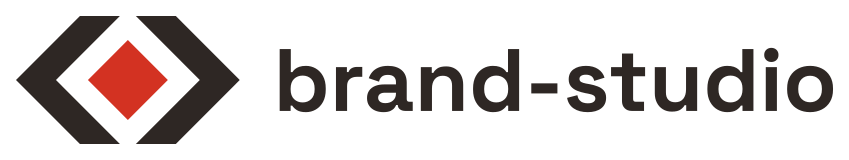
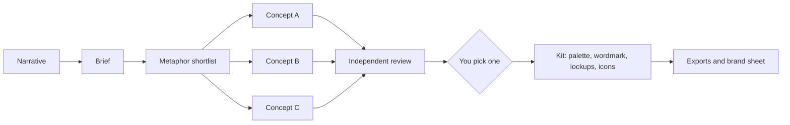
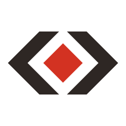
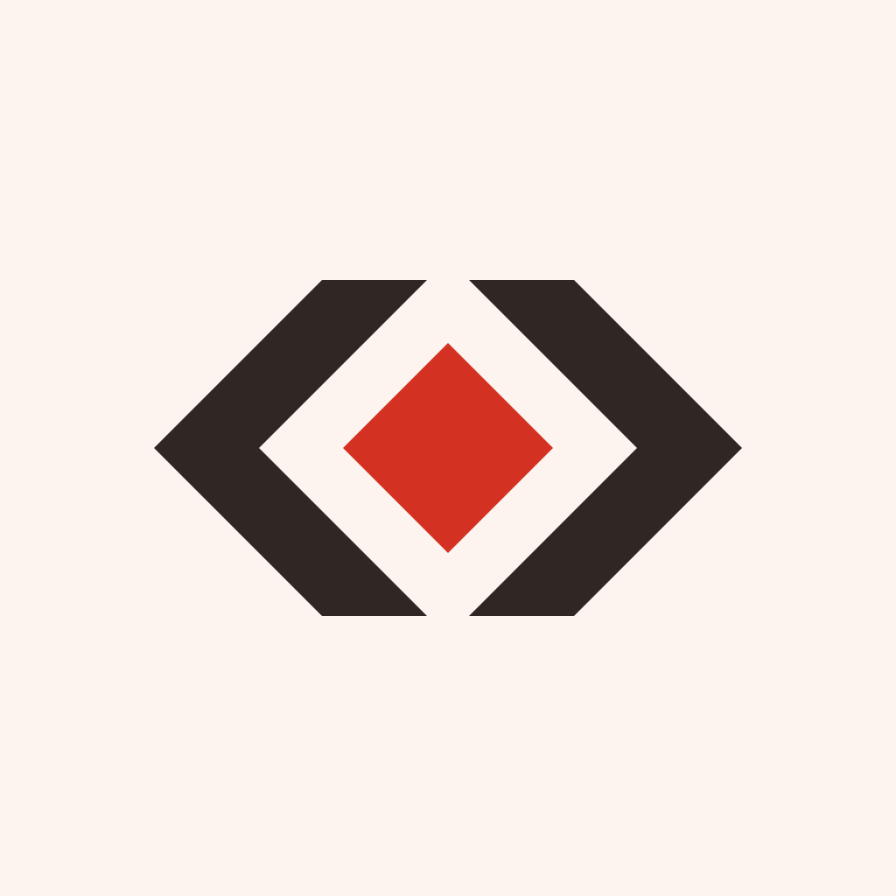
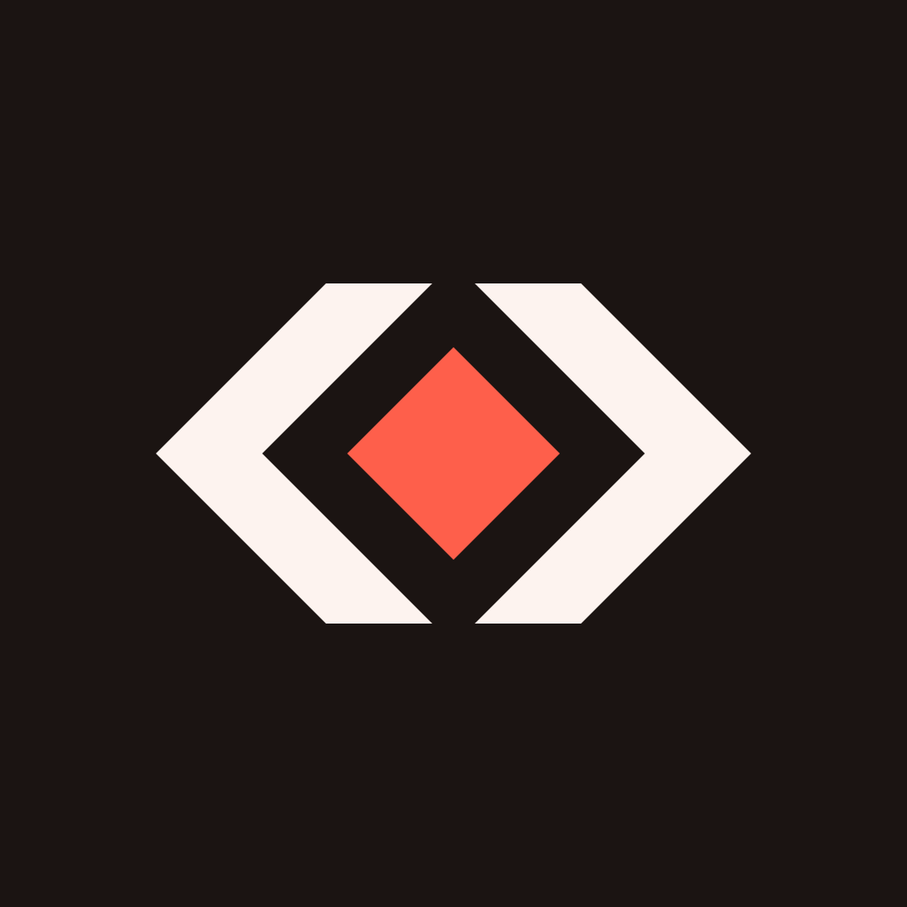
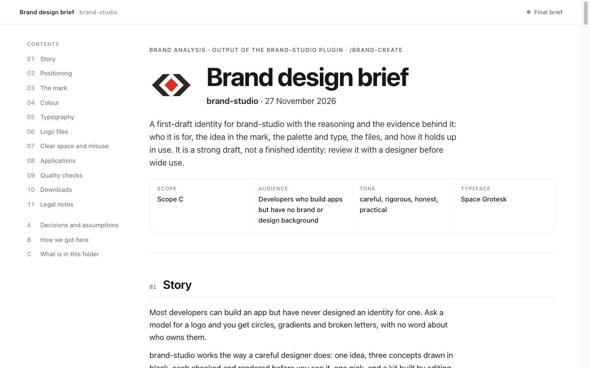
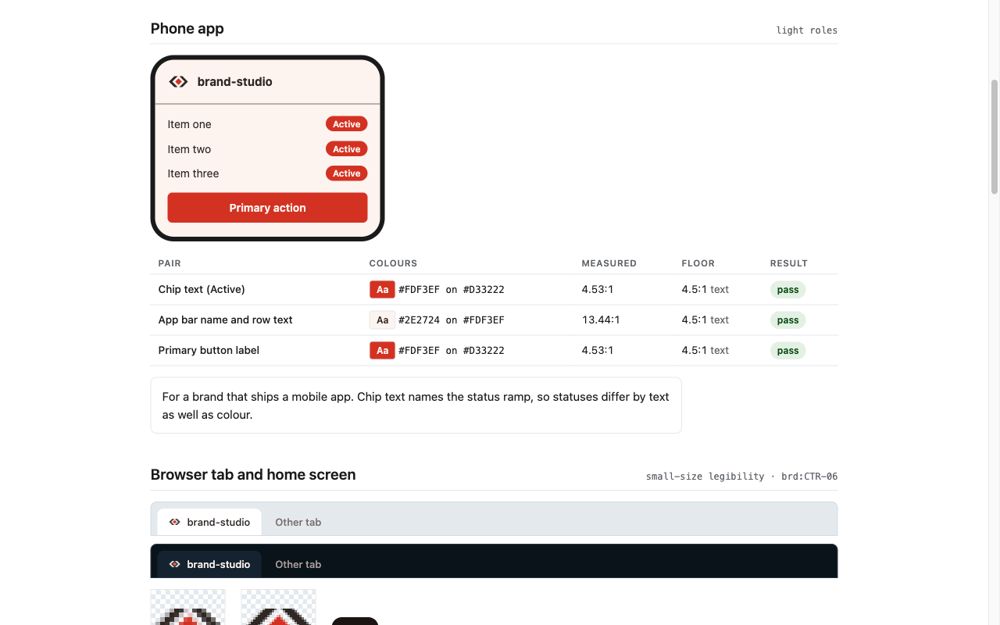

<p align="center">
  <picture>
    <source media="(prefers-color-scheme: dark)" srcset="examples/brand-studio/brand/lockup-horizontal-reversed.svg">
    
  </picture>
</p>

# brand-studio

You can build an app, but you have never designed an identity for one. Ask a model for a logo and you get circles, gradients and broken letters, with no word about who owns the result.

brand-studio is a Claude Code plugin that works the way a careful designer does. It turns a few paragraphs about your project into a first-draft brand identity as SVG: concept, mark, wordmark, lockups, palette, exports and a one-page brand sheet. Every mark is checked against numbered, sourced rules before you see it. It also reviews SVG logos you already have.

It makes a strong first draft for developers and small teams. It does not replace a designer.

## Install

```
/plugin marketplace add zepedrosilva/claude-plugins
/plugin install brand-studio@zepedrosilva
```

Then run `/brand-studio:brand-create` with your project's story, a README or a pitch.

## Requirements

Only Claude Code is required. The tools below are optional. At the start of a run the plugin checks for them, lists what is missing and asks whether to install it. Say yes and it runs [`install-deps.sh`](plugin/skills/brand-core/scripts/install-deps.sh), which prints every command before it runs. Say no and the run carries on: the rules still apply, but they are judged by reading the SVG and not proven by a script or a render.

| Tool | Used for | Without it |
|---|---|---|
| Python 3 | All the `brd` scripts (standard library only) | Every rule is judged by reading the files |
| `resvg` or `rsvg-convert` | Renders at 16 to 1024 px, PNG exports | Render rules stay `review`, so the verdict is `incomplete`, and there are no PNGs |
| `fontTools` | Outlining the wordmark from a font file, glyph coverage | You outline the name in a font tool and supply the SVG |
| `uharfbuzz` (optional) | Full kerning and non-Latin shaping | Only the font's pair kerning applies |
| `svgo` (optional, not installed by the script) | Optimising the final files | Files stay as drawn |

The script installs the renderer with Homebrew or apt. It puts `fontTools` and `uharfbuzz` (pinned) in a private venv in the plugin's data folder, so your global Python is never touched. To check without installing, run `install-deps.sh --check`. An image-capable model is strongly recommended, because the reviewer looks at the renders.

## How it works



1. **Brief.** Your narrative becomes a brief with an essence, a positioning line and a word to own. The plugin asks once for anything missing, always with a suggested answer.
2. **Shortlist.** It writes 8 to 12 metaphor lines, names the clichés of your category and scores each line. Three distinct lines go forward.
3. **Three concepts, in parallel.** A designer agent draws each one in greyscale, primitives first, and self-checks it with the scripts and renders.
4. **One checkpoint.** A reviewer agent on a different model checks all three. You see them side by side with a recommendation and pick one.
5. **The kit.** The kit is built by editing your pick, not redrawing it. It contains a palette with light and dark roles, an outlined wordmark, lockups, an optional icon set, a favicon, app icons and a social image.
6. **Exports.** You get SVG copies and transparent PNGs at 16 to 1024 px, a zip, an applications page that shows the kit in use with every colour pair measured, and a brand sheet with legal warnings.

A live page at `127.0.0.1` shows the questions and the work as it appears. When the run ends it becomes the brand design brief.

## Example

This repo's own identity was made with the plugin: [`examples/brand-studio/brand/`](examples/brand-studio/brand/). The narrative is in [`narrative.md`](examples/brand-studio/narrative.md), and the brand sheet, the review record and every export sit beside it.

<p>
  
  &nbsp;
  
  &nbsp;
  
</p>

The run ends with a brand design brief, a single page covering story, positioning, mark, colour, type, files, checks, downloads and legal notes:



It also writes an applications page that places the kit in a phone app, a browser tab, a web page, a dark card, a slide and a flyer, and measures every colour pair against its contrast floor:



## What it does differently

Plenty of skills already generate SVG logos. This one adds four things:

1. **A narrative-to-concept method.** The concept comes from your story through an essence, a shortlist and scored metaphors, not from the first shape that comes to mind.
2. **Real wordmarks.** Letters are shaped, kerned outlines from an OFL or Apache font, with the licence recorded. The model never draws letters.
3. **A numbered rule catalogue.** A review cites `brd:CRF-02` and its fix instead of giving a score. Each finding says what decided it: `script`, `render` or `judgment`.
4. **Legal warnings.** Every brand sheet and review carries a block on AI-assisted copyright, trademark clearance and font licences. These are warnings only, US-centred, and not advice.

## Skills and agents

| Skill | Invoke | Does |
|---|---|---|
| `brand-create` | `/brand-studio:brand-create <narrative or file>` | Brief, shortlist, three concepts, one checkpoint, then the kit |
| `brand-review` | `/brand-studio:brand-review <svg, folder or png>` | Verdict with rule IDs, evidence levels and legal warnings |
| `brand-core` | loaded by the others | Principles, rule catalogue, thresholds, colour, type and positioning references |

| Agent | Model | Role |
|---|---|---|
| `brand-designer` | opus | Draws one concept; three run in parallel |
| `brand-reviewer` | sonnet | Checks and renders, then returns a verdict; never edits |

Rule families: `DEC` brief, `CNC` concept, `CTR` file contract, `CAP` budgets, `CRF` craft, `TYP` lettering and type, `SET` icon sets, `SEC` SVG safety, `EVD` evidence, `LGL` legal, `PAL` palette, `POS` positioning. The full catalogue is in [`rules.md`](plugin/skills/brand-core/references/rules.md).

Scope: **A** is a mark, one colour and a favicon. **B** (the default) adds a wordmark, lockups, palette roles, a type pick and a brand sheet. **C** adds dark variants, a colour-blind report, an icon set, an app icon and social assets. Every scope ends with the export set.

## Limits

- First drafts, not brand strategy. Have a designer review the result before wide use.
- Flat, geometric marks with few shapes work best. Organic illustration does not.
- No hosted image or vector generator, no tracing of raster logos and no custom lettering.
- Masters are static SVG 1.1: no live text, images, filters or scripts.
- Legal notes cover the US only and carry recheck dates.

## Research and credits

Every rule and threshold cites a source in [`plugin/research/`](plugin/research/): [`brd-research.md`](plugin/research/brd-research.md) for craft, evidence and legal, and [`brd-colour-type-research.md`](plugin/research/brd-colour-type-research.md) for colour, type and positioning. Decisions and their reasons are in [`docs/decisions/`](docs/decisions/README.md).

Ideas were borrowed, paraphrased, from these open-source logo skills and tools (no text copied): kaankiziltug/logo-design-skill (MIT; checkpoint, black first, construction checks), mcpware/logoloom (MIT; separate text-to-path, optimise and export tools), op7418/logo-generator-skill (MIT; restraint, one focal point), neonwatty/logo-designer-skill (MIT; parallel concepts, favicon strip, edit rather than regenerate) and jezweb's icon-set-generator (style spec for icon sets).

## Contributing

See [CONTRIBUTING.md](CONTRIBUTING.md). Security issues: [SECURITY.md](SECURITY.md). Licence: [MIT](LICENSE).
